# xenho-cover

一个给 AI Agent 使用的封面生成 Skill。

把一篇文章、一个主题、一条小红书笔记或一篇公众号推文，变成一份**完整的图像生成提示词**，也可以直接出图。风格来自自建风格库——29 个风格原子分成 6 个气质家族，从原研哉式留白到艺术馆展览海报，各自有明确的适用边界。

两种模式：

- **Prompt 模式**：只产提示词。提示词是自包含的：填实了色值、构图、字体、文字白名单和终检标准，复制粘贴到 GPT Image 系列即可用。README 里的全部示例图都由这些提示词经 GPT Image-2 直接生成，未做任何后期修改。
- **Direct 模式**：编译同一份提示词后经任意 OpenAI 兼容的图像接口直接出图，默认模型 `gpt-image-2`（也可以指定 `gemini-3.1-flash-image`）。`scripts/cover_generate.py` 内置防重复出图：每个画幅最多发一次（公众号是横版 + 方版两个画幅），没拿到输出也不会自动重发。配置见 [`references/direct-mode.md`](references/direct-mode.md)。

## 安装

在 Claude Code 或 codex 里执行：

```
把 https://github.com/PPory/xenho-cover 安装为我的 skill
```

或手动克隆后建立链接（Windows）：

```powershell
git clone https://github.com/PPory/xenho-cover.git
New-Item -ItemType Junction -Path C:/Users/<你的用户名>/.claude/skills/xenho-cover -Target <克隆路径>
```

macOS / Linux：

```bash
git clone https://github.com/PPory/xenho-cover.git
ln -s <克隆路径> ~/.claude/skills/xenho-cover
```

安装后在任意会话说「给这篇文章配个封面」即可触发。

## 包含的 Skill

| Skill | 用途 |
| --- | --- |
| `xenho-cover` | 把文章 / 主题编译成封面图像提示词，29 个风格原子任选其一 |

## 用法

### 基础：贴一篇文章

```
给这篇文章配个封面：<粘贴全文>，公众号
```

Skill 会提炼标题三层、视觉隐喻、情绪和禁用元素，推荐 3 个候选风格，确认后编译出完整提示词。

### 指定风格

```
用 tile-crossword 风格给这篇文章配个公众号封面
```

点名风格时跳过推荐环节，直接编译。

### 指定平台与比例

```
小红书封面，polish-grain-collage 风格，主题：专注是一种反抗
```

平台与比例映射：小红书 `3:4`、公众号 `3.35:1`、X `5:2`、视频号 `3:4`、YouTube `16:9`，也可以直接给自定义比例。**没给平台也没给比例时，Skill 会先停下来问**——比例错了整张图作废。

公众号的 `3.35:1` 是上传用的拼合图：后台只收一张封面，再分别框选 2.35:1 头条和 1:1 转发卡片 / 文章列表。Skill 会出横版、方版两张各自构图的图，用 `scripts/wechat_combine.py` 左右拼成一张；上传后把 2.35:1 框拖到最左、1:1 框拖到最右。（2026-10 在后台实测可行。框拖不动时先关掉浏览器扩展再试：实测有扩展会拦截编辑封面窗口里的鼠标事件。）

### 要英文提示词

提示词默认输出中文（GPT Image 系列和 gemini-3.1-flash-image 对中文提示词和中文字形的还原都良好）。需要英文版时明说：

```
用 film-poster-icon 风格配个封面，输出英文提示词
```

## 风格库

29 个风格分成 6 个气质家族，内容匹配与平台推荐见 [`references/style-catalog.md`](references/style-catalog.md)。

| 家族 | 风格 | Style ID | 视觉语言 |
| --- | --- | --- | --- |
| 排版系统 | 字格填字系统 | `tile-crossword` | 填字游戏式方格网，一字一格，单色调 + 四角档案小字 |
| 排版系统 | 巨型数字 | `giant-numeral` | 出血裁切的巨型无衬线数字 + 一条信号红 + 中号标题 |
| 排版系统 | 艺术馆展览海报 | `exhibition-poster` | 巨字撑满上半部 + 三栏信息 + 荧光贴纸圆 |
| 排版系统 | 瑞士音乐会海报 | `swiss-concert-poster` | Müller-Brockmann 式几何节律，在一处发生变化 |
| 排版系统 | 瑞士朋克层叠 | `swiss-punk-layers` | Weingart 式网屏叠印、莫尔纹、阶梯标题 |
| 排版系统 | 瑞士网格手写对撞 | `swiss-grid-scrawl` | 瑞士网格印刷品浮在满纸手迹上 + 高亮黄卡片 |
| 排版系统 | 黑白字体样张 | `bw-type-specimen` | 纯黑白 + 弧线切分正负空间 + 巨型衬线字跨区反色 |
| 印刷物件 | 精装书封 | `cloth-book-jacket` | 细纹布面 + 烫金单线徽记 + 烫金宋体 |
| 印刷物件 | 档案索引卡 | `archive-index-card` | 红蓝格线索引卡 + 打字机字段 + 红色橡皮章 |
| 印刷物件 | 药剂师标签 | `apothecary-label` | 琥珀瓶身上的纸标签，居中对称的配方排版 |
| 印刷物件 | 热敏小票 | `thermal-receipt` | 饱和色底上的热敏小票，把观点写成一笔账 |
| 印刷物件 | 蓝图技术图纸 | `blueprint-drawing` | 普鲁士蓝晒图 + 白色工程线稿 + 图签栏 |
| 印刷物件 | 点阵规格书 | `dot-matrix-spec` | TE 说明书式圆点像素巨字 + 标注 + 规格表 |
| 印刷物件 | 日本杂志特集 | `jp-magazine-special` | 纯色底 + 自造刊名 + 去底物件照 + 层级丰富的小字 |
| 东方与留白 | 原研哉留白 | `hara-emptiness` | 大片纸色留白 + 侧光静物 + 竖排细宋体，用缺席讲隐喻 |
| 东方与留白 | 新中式水墨 | `ink-zen-modern` | 宣纸笔触 vs 精确朱红几何 + 竖排宋体 + 小方印 |
| 东方与留白 | 田中一光几何 | `tanaka-geometry` | 几何色块在网格上拼出形象，五色平涂 |
| 摄影与实物 | 概念静物摄影 | `concept-still-life` | 饱和背景纸 + 两物嫁接的超现实物件 + 硬光 |
| 摄影与实物 | 电影感摄影排版 | `cinematic-photo-editorial` | 满幅出血单色调实拍 + 巨字长在景深里 + 虚构徽章 |
| 摄影与实物 | 概念物电影海报 | `film-poster-icon` | 饱和实色底 + 巨型概念物剪影 + 微小人影的尺度对比 |
| 插画与手作 | Riso 双色印刷 | `riso-two-ink` | 两色孔版叠印、颗粒与套色错位、稚拙手绘 |
| 插画与手作 | 软陶 3D | `soft-clay-3d` | 糖果色哑光软陶小装置，柔光 |
| 插画与手作 | Anthropic Research 风格 | `anthropic-research` | 纯色底 + 衬线大标题 + 有机色块承载的抽象隐喻线稿 |
| 插画与手作 | Notion 手绘信息图 | `notion-doodle` | 纸白底 + 马克笔黑白墨线 + 五种构图型的信息图 |
| 插画与手作 | 波兰颗粒剪贴海报 | `polish-grain-collage` | 炭黑底 + 逐字散落的标题 + 颗粒肌理形块 + 一块朱红 |
| 插画与手作 | 撕纸摄影拼贴 | `torn-photo-collage` | 黑白纪实摄影撕裂重拼 + 深红压场 + 牛皮纸层叠 |
| 插画与手作 | 复古半调波普 | `retro-halftone-pop` | 动画线稿 + 粗 CMYK 半调网点 + 高饱和三色撞色 |
| 氛围 | 颗粒渐变光晕 | `grainy-gradient` | 柔焦色彩光球 + 胶片颗粒 + 干净大字 |
| 氛围 | 赛博工业面板 | `cyber-industrial-panel` | 纯黑装甲面板 45° 咬合 + 浅灰走线 + 放射刻度圆 |

## 风格示例

全部由 GPT Image 直接生成，未做任何后期修改。每个风格配一个最适合它的题目，可以当成「什么内容配什么风格」的参考。下方为缩略图，**点击可查看全尺寸原图**。

### 小红书 `3:4`

**排版系统**

<table>
<tr>
<td width="25%"><a href="example-image/tile-crossword.png">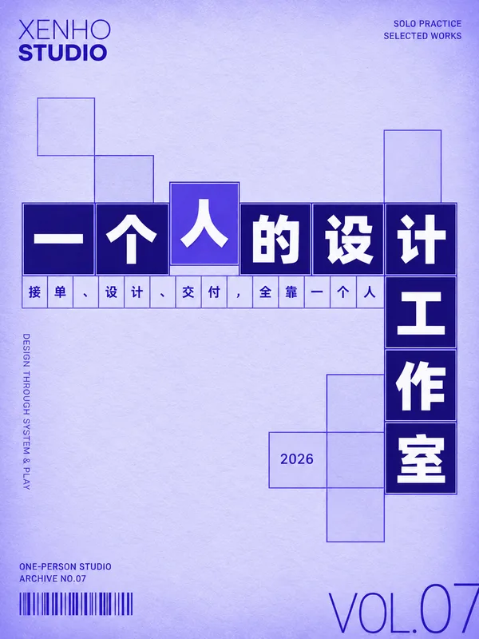</a><br><b>字格填字系统</b> <code>tile-crossword</code><br><sub>「一个人的设计工作室」</sub></td>
<td width="25%"><a href="example-image/giant-numeral.png">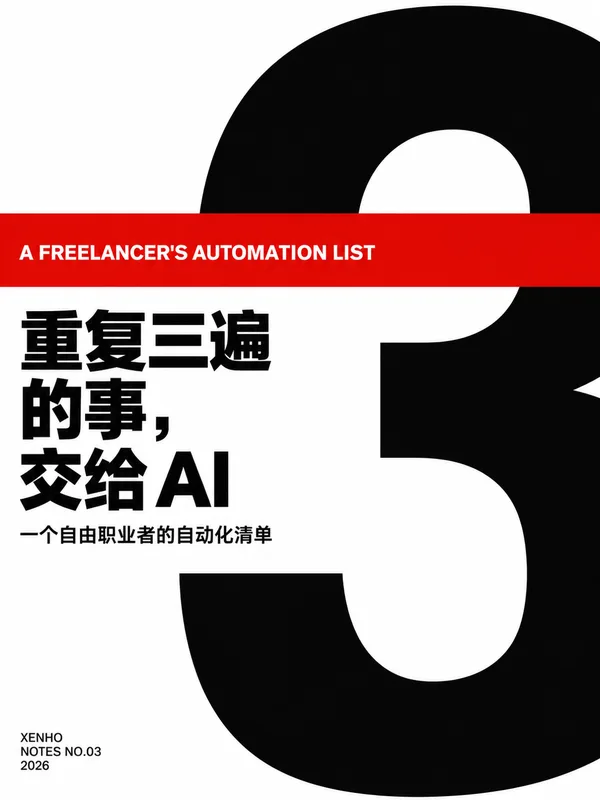</a><br><b>巨型数字</b> <code>giant-numeral</code><br><sub>「自由职业第 365 天」</sub></td>
<td width="25%"><a href="example-image/exhibition-poster.png">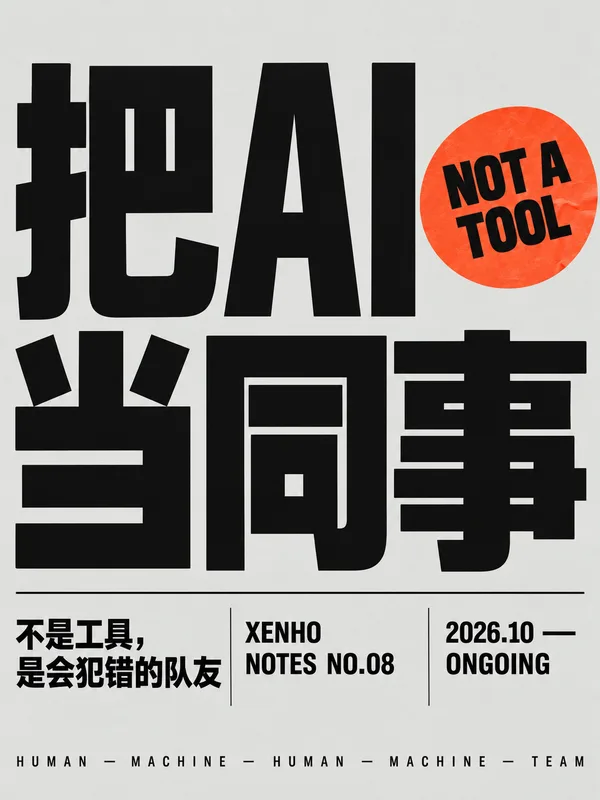</a><br><b>艺术馆展览海报</b> <code>exhibition-poster</code><br><sub>「把 AI 当同事」</sub></td>
<td width="25%"><a href="example-image/swiss-concert-poster.png">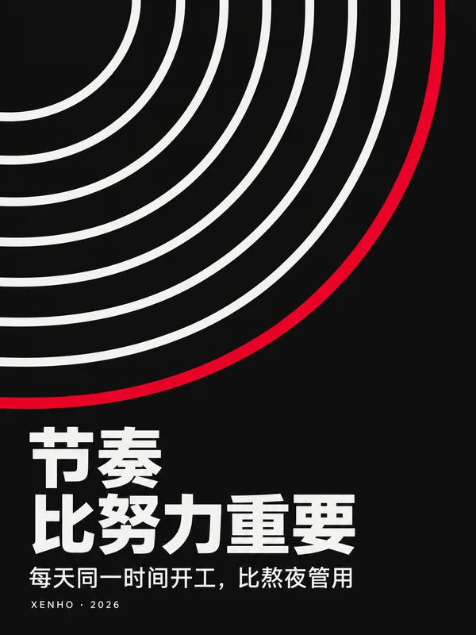</a><br><b>瑞士音乐会海报</b> <code>swiss-concert-poster</code><br><sub>「节奏比努力重要」</sub></td>
</tr>
<tr>
<td width="25%"><a href="example-image/swiss-punk-layers.png">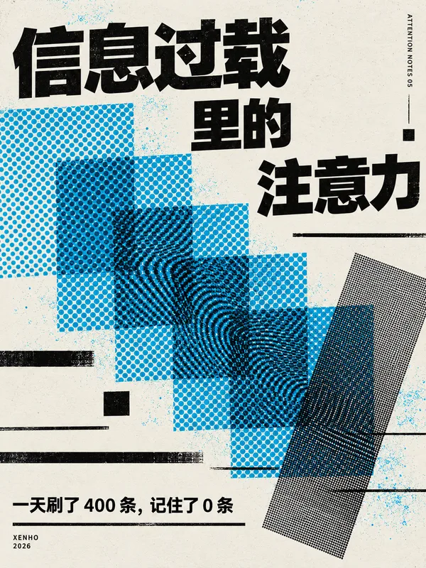</a><br><b>瑞士朋克层叠</b> <code>swiss-punk-layers</code><br><sub>「信息过载里的注意力」</sub></td>
<td width="25%"><a href="example-image/swiss-grid-scrawl.png">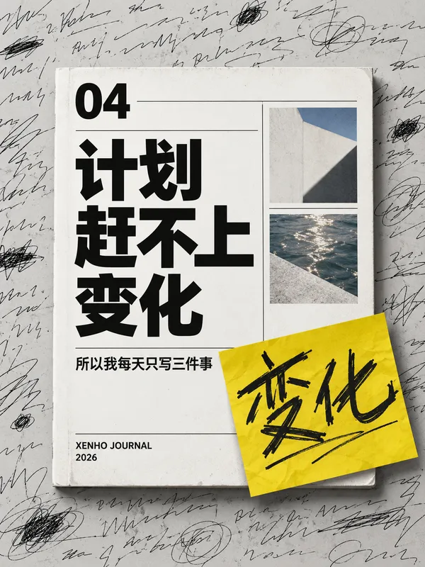</a><br><b>瑞士网格手写对撞</b> <code>swiss-grid-scrawl</code><br><sub>「计划赶不上变化」</sub></td>
<td width="25%"><a href="example-image/bw-type-specimen.png">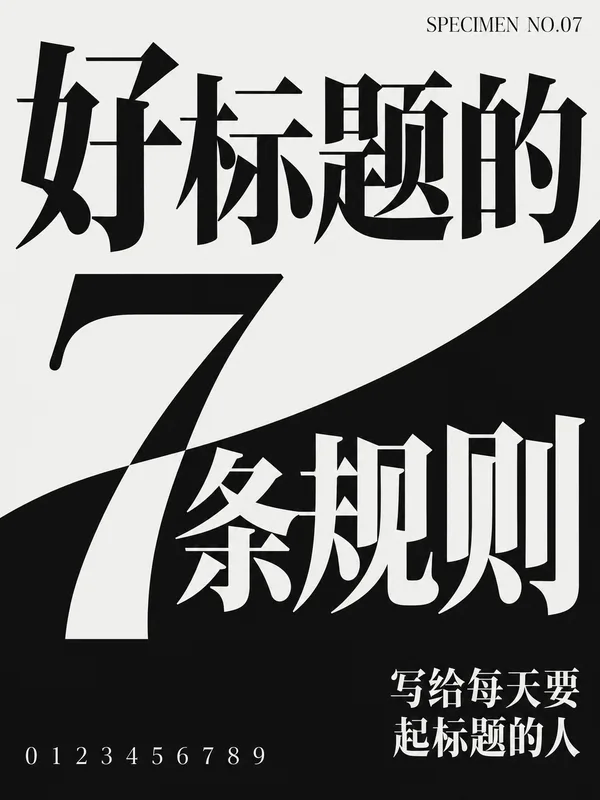</a><br><b>黑白字体样张</b> <code>bw-type-specimen</code><br><sub>「好标题的 7 条规则」</sub></td>
<td></td>
</tr>
</table>

**印刷物件**

<table>
<tr>
<td width="25%"><a href="example-image/cloth-book-jacket.png">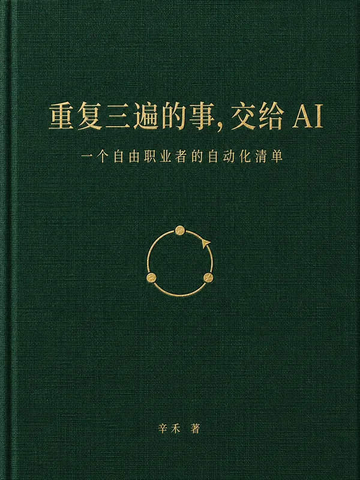</a><br><b>精装书封</b> <code>cloth-book-jacket</code><br><sub>「慢慢变富的笨办法」</sub></td>
<td width="25%"><a href="example-image/archive-index-card.png">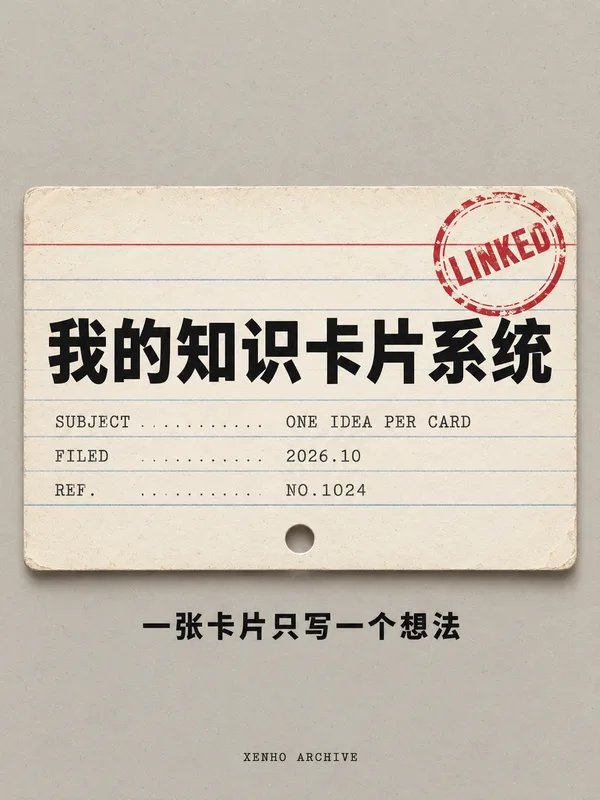</a><br><b>档案索引卡</b> <code>archive-index-card</code><br><sub>「我的知识卡片系统」</sub></td>
<td width="25%"><a href="example-image/apothecary-label.png">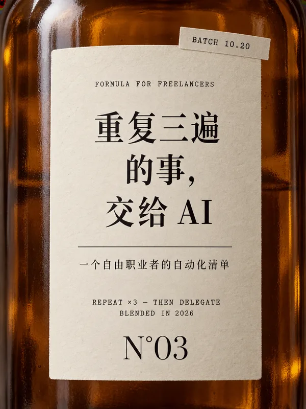</a><br><b>药剂师标签</b> <code>apothecary-label</code><br><sub>「治拖延的三味药」</sub></td>
<td width="25%"><a href="example-image/thermal-receipt.png">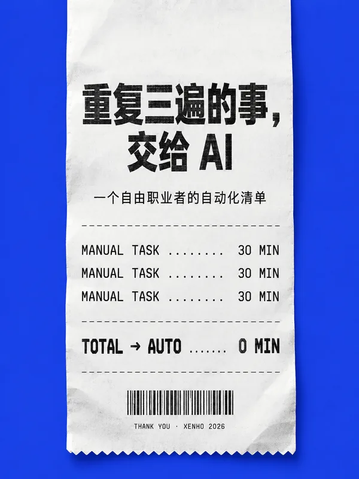</a><br><b>热敏小票</b> <code>thermal-receipt</code><br><sub>「订了 12 个 AI 工具，只用 2 个」</sub></td>
</tr>
<tr>
<td width="25%"><a href="example-image/blueprint-drawing.png">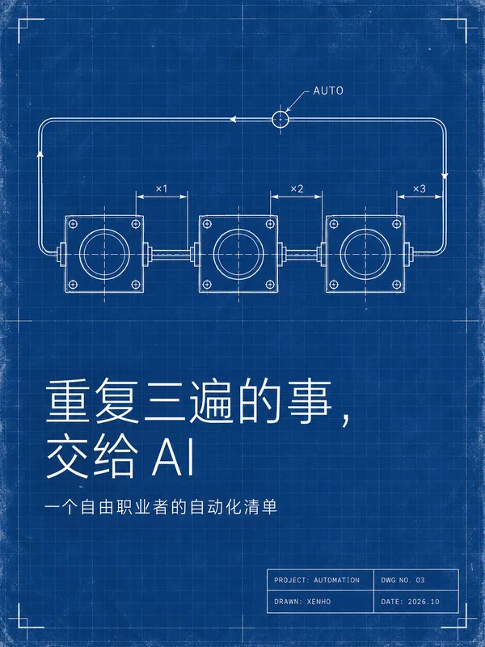</a><br><b>蓝图技术图纸</b> <code>blueprint-drawing</code><br><sub>「搭一条自动化内容流水线」</sub></td>
<td width="25%"><a href="example-image/dot-matrix-spec.png">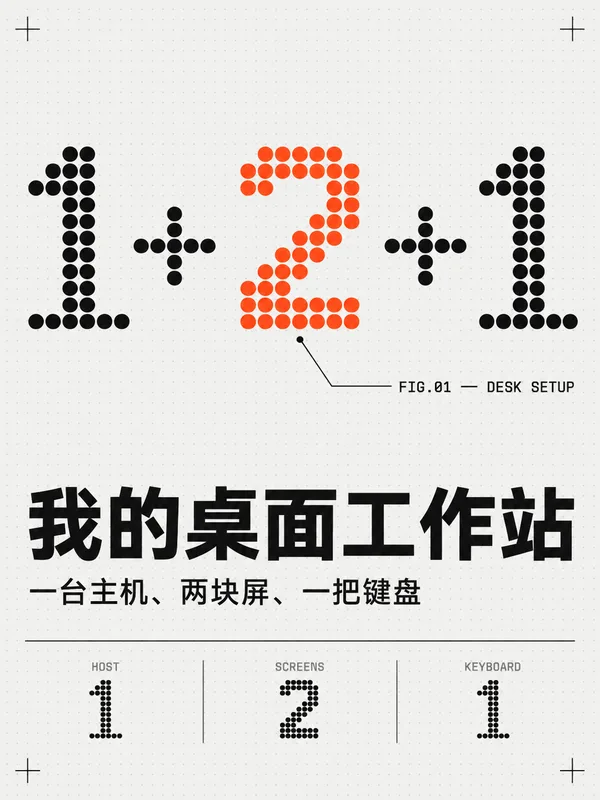</a><br><b>点阵规格书</b> <code>dot-matrix-spec</code><br><sub>「我的桌面工作站」</sub></td>
<td width="25%"><a href="example-image/jp-magazine-special.png">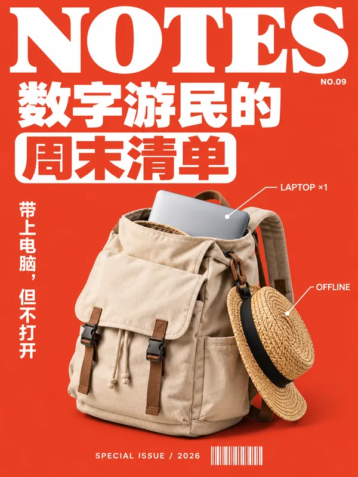</a><br><b>日本杂志特集</b> <code>jp-magazine-special</code><br><sub>「数字游民的周末清单」</sub></td>
<td></td>
</tr>
</table>

**东方与留白**

<table>
<tr>
<td width="25%"><a href="example-image/hara-emptiness.png">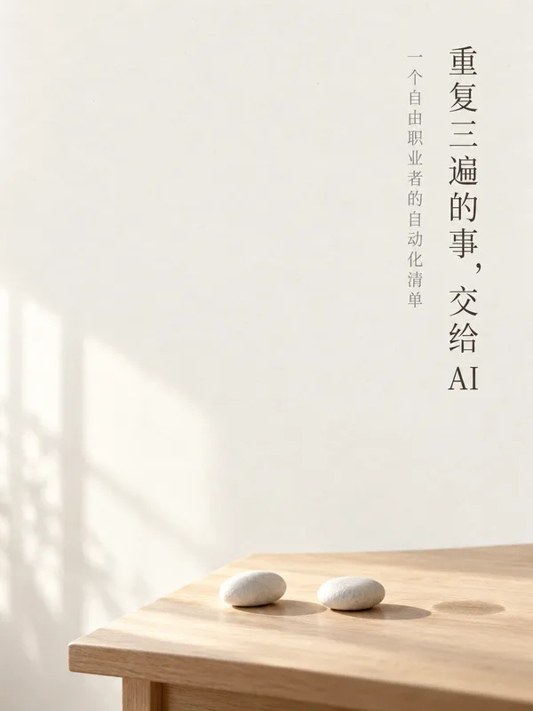</a><br><b>原研哉留白</b> <code>hara-emptiness</code><br><sub>「桌上只剩一支笔」</sub></td>
<td width="25%"><a href="example-image/ink-zen-modern.png">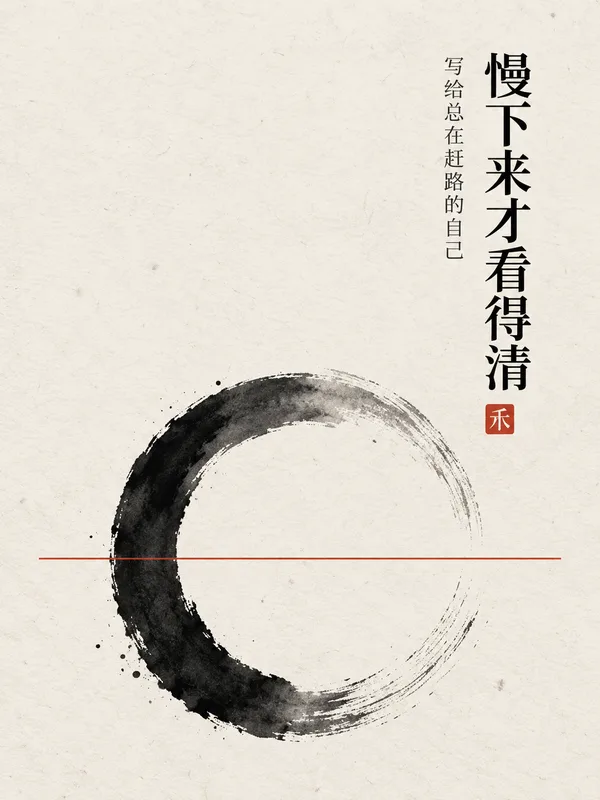</a><br><b>新中式水墨</b> <code>ink-zen-modern</code><br><sub>「慢下来才看得清」</sub></td>
<td width="25%"><a href="example-image/tanaka-geometry.png">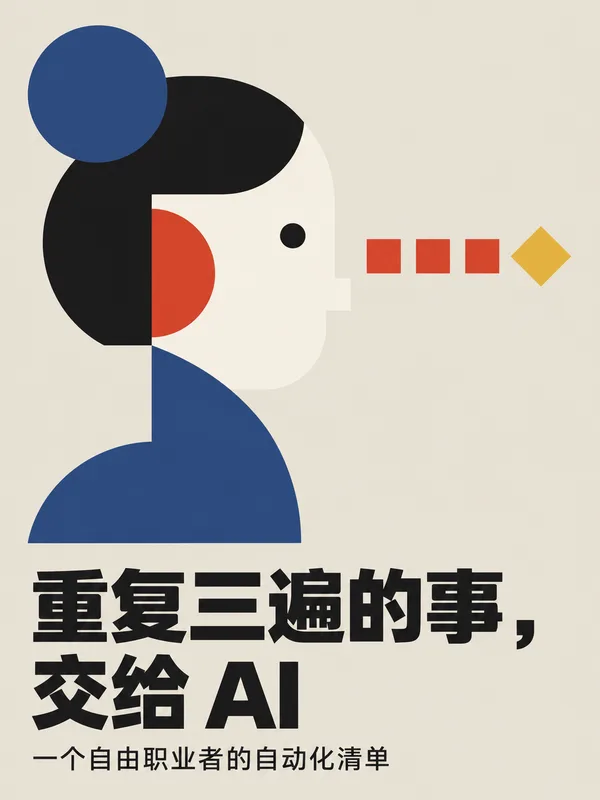</a><br><b>田中一光几何</b> <code>tanaka-geometry</code><br><sub>「一个工程师的转行笔记」</sub></td>
<td></td>
</tr>
</table>

**摄影与实物**

<table>
<tr>
<td width="25%"><a href="example-image/concept-still-life.png">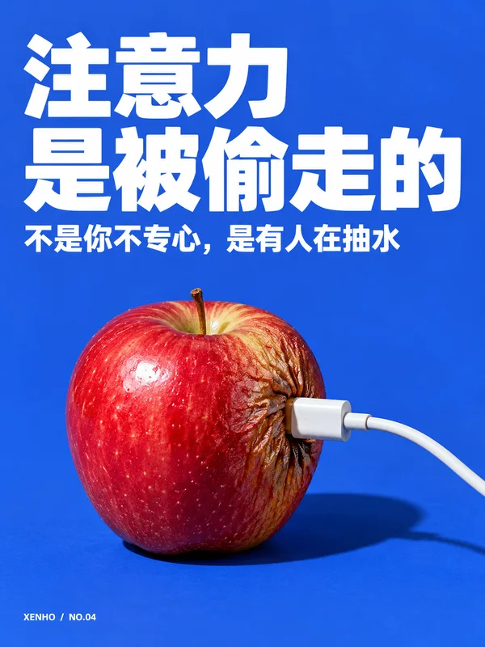</a><br><b>概念静物摄影</b> <code>concept-still-life</code><br><sub>「注意力是被偷走的」</sub></td>
<td width="25%"><a href="example-image/cinematic-photo-editorial.png"></a><br><b>电影感摄影排版</b> <code>cinematic-photo-editorial</code><br><sub>「离开大厂的那个下午」</sub></td>
<td width="25%"><a href="example-image/film-poster-icon.png">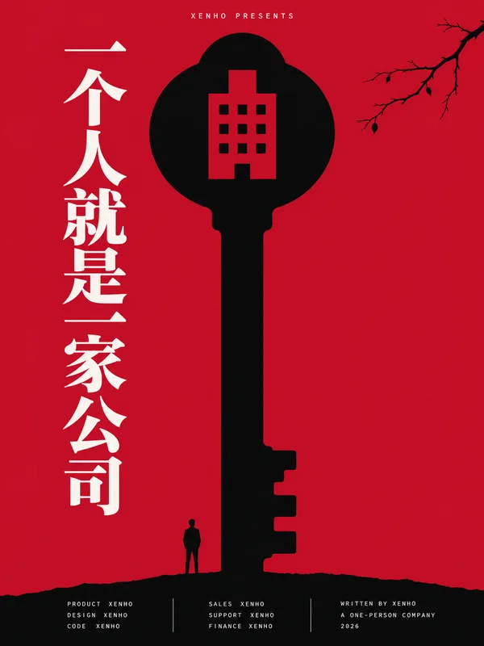</a><br><b>概念物电影海报</b> <code>film-poster-icon</code><br><sub>「一个人就是一家公司」</sub></td>
<td></td>
</tr>
</table>

**插画与手作**

<table>
<tr>
<td width="25%"><a href="example-image/riso-two-ink.png">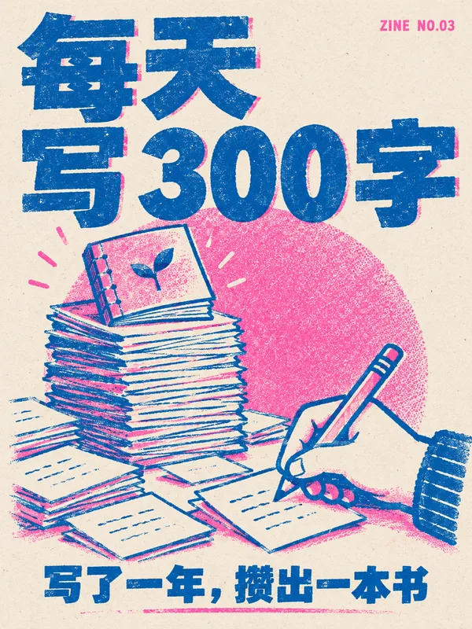</a><br><b>Riso 双色印刷</b> <code>riso-two-ink</code><br><sub>「每天写 300 字」</sub></td>
<td width="25%"><a href="example-image/soft-clay-3d.png">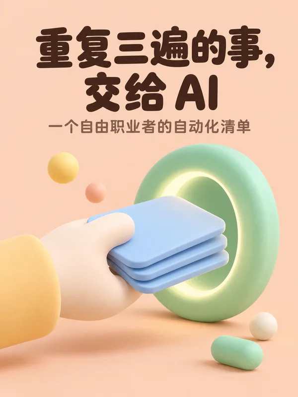</a><br><b>软陶 3D</b> <code>soft-clay-3d</code><br><sub>「零基础搭一个 AI 助手」</sub></td>
<td width="25%"><a href="example-image/anthropic-research.png">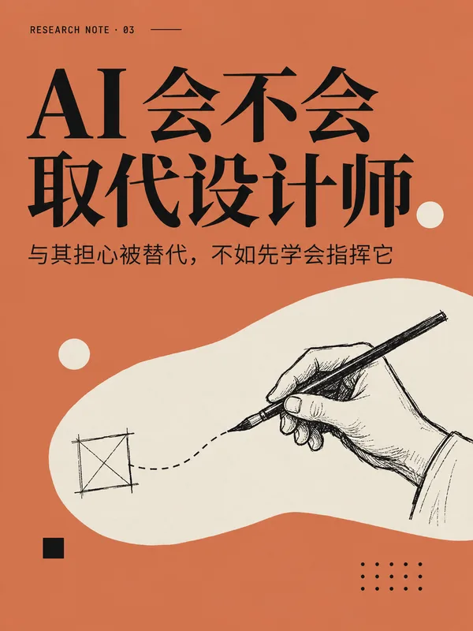</a><br><b>Anthropic Research 风格</b> <code>anthropic-research</code><br><sub>「AI 会不会取代设计师」</sub></td>
<td width="25%"><a href="example-image/notion-doodle.png"></a><br><b>Notion 手绘信息图</b> <code>notion-doodle</code><br><sub>「用 AI 写代码的 4 个步骤」</sub></td>
</tr>
<tr>
<td width="25%"><a href="example-image/polish-grain-collage.png">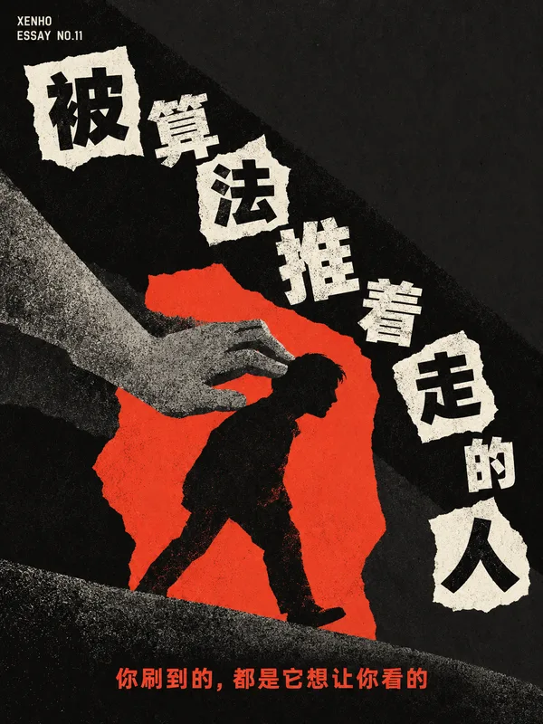</a><br><b>波兰颗粒剪贴海报</b> <code>polish-grain-collage</code><br><sub>「被算法推着走的人」</sub></td>
<td width="25%"><a href="example-image/torn-photo-collage.png">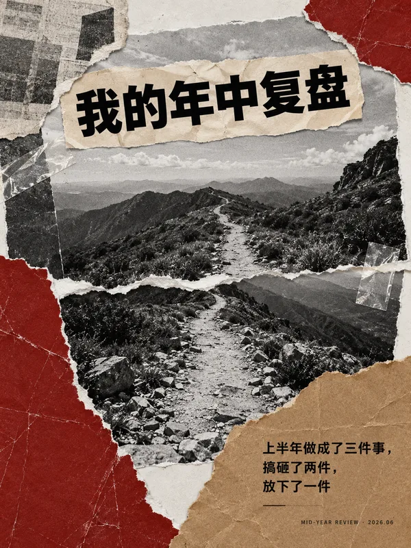</a><br><b>撕纸摄影拼贴</b> <code>torn-photo-collage</code><br><sub>「我的年中复盘」</sub></td>
<td width="25%"><a href="example-image/retro-halftone-pop.png">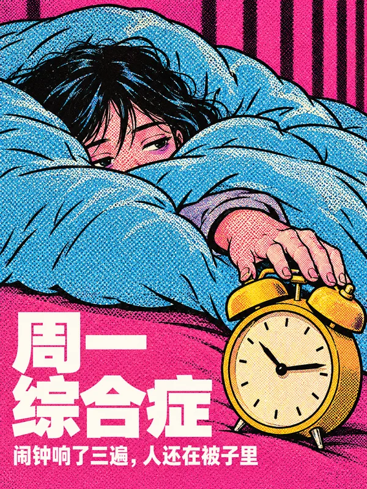</a><br><b>复古半调波普</b> <code>retro-halftone-pop</code><br><sub>「周一综合症」</sub></td>
<td></td>
</tr>
</table>

**氛围**

<table>
<tr>
<td width="25%"><a href="example-image/grainy-gradient.png">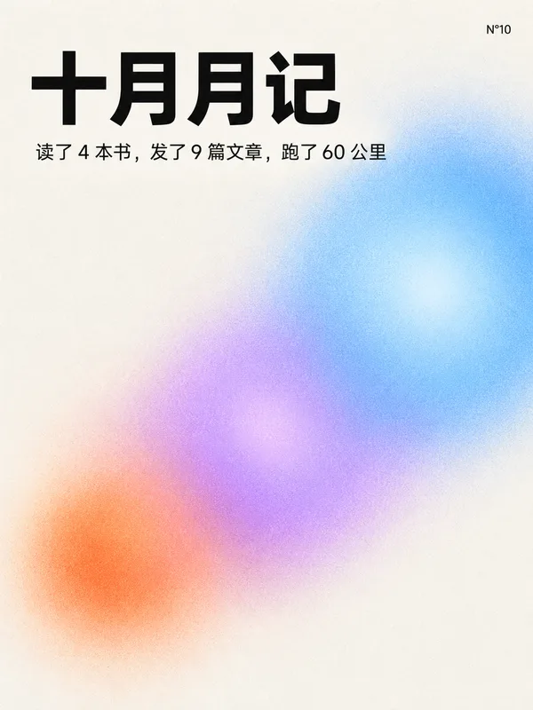</a><br><b>颗粒渐变光晕</b> <code>grainy-gradient</code><br><sub>「十月月记」</sub></td>
<td width="25%"><a href="example-image/cyber-industrial-panel.png">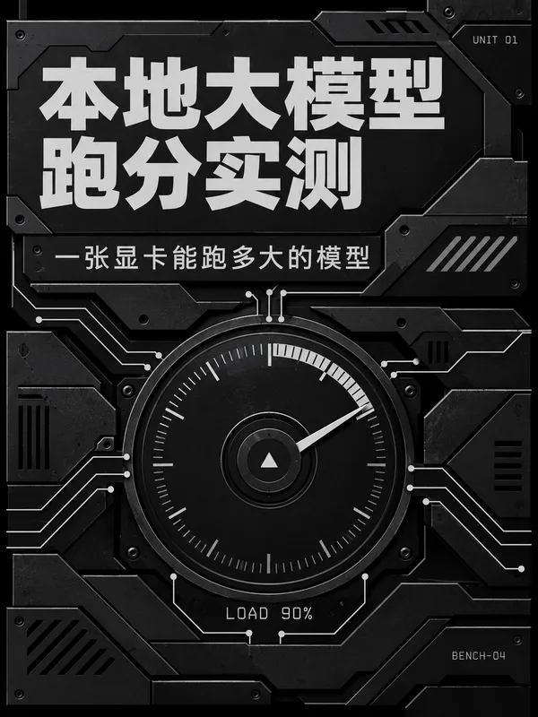</a><br><b>赛博工业面板</b> <code>cyber-industrial-panel</code><br><sub>「本地大模型跑分实测」</sub></td>
<td></td>
<td></td>
</tr>
</table>

### 公众号 `3.35:1`

公众号封面是一张图上框两次：2.35:1 给订阅号消息里的头条，1:1 给转发卡片和文章列表。所以横版和方版各画一张、再拼成一张 3.35:1 上传，在后台把 2.35:1 框拖到最左、1:1 框拖到最右，两个框都落在完整的设计上。

<table>
<tr>
<td width="50%"><a href="example-image/wechat/giant-numeral.png">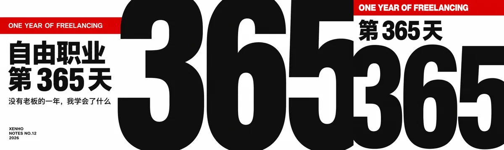</a><br><b>巨型数字</b> <code>giant-numeral</code><br><sub>「自由职业第 365 天」</sub></td>
<td width="50%"><a href="example-image/wechat/blueprint-drawing.png">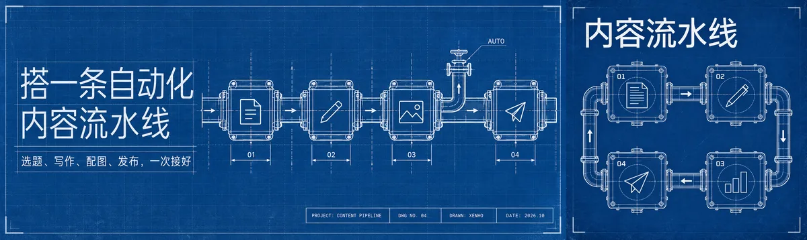</a><br><b>蓝图技术图纸</b> <code>blueprint-drawing</code><br><sub>「搭一条自动化内容流水线」</sub></td>
</tr>
<tr>
<td width="50%"><a href="example-image/wechat/hara-emptiness.png">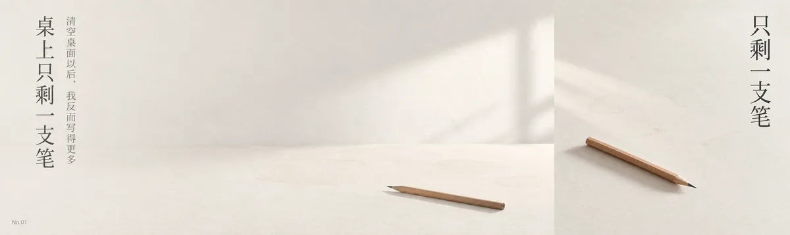</a><br><b>原研哉留白</b> <code>hara-emptiness</code><br><sub>「桌上只剩一支笔」</sub></td>
<td width="50%"><a href="example-image/wechat/concept-still-life.png">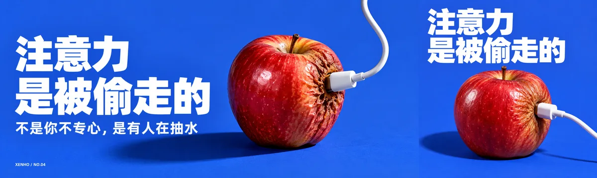</a><br><b>概念静物摄影</b> <code>concept-still-life</code><br><sub>「注意力是被偷走的」</sub></td>
</tr>
<tr>
<td width="50%"><a href="example-image/wechat/notion-doodle.png"></a><br><b>Notion 手绘信息图</b> <code>notion-doodle</code><br><sub>「用 AI 写代码的 4 个步骤」</sub></td>
<td width="50%"><a href="example-image/wechat/grainy-gradient.png">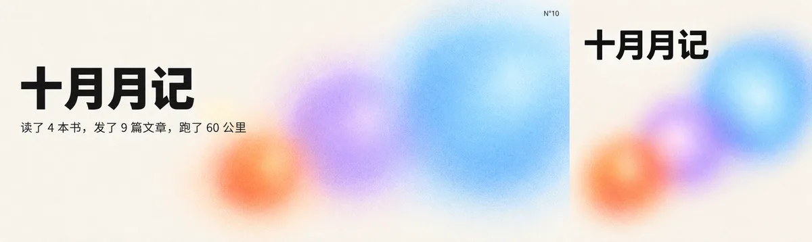</a><br><b>颗粒渐变光晕</b> <code>grainy-gradient</code><br><sub>「十月月记」</sub></td>
</tr>
</table>

## 目录结构

```
xenho-cover/
├── SKILL.md                    # skill 入口：模式判定 + 工作流 + 门控 + Gotchas
├── references/
│   ├── cover-prompt-blueprint.md   # 最终提示词的结构（封面形状）
│   ├── style-catalog.md            # 风格菜单、内容匹配、平台推荐
│   └── direct-mode.md              # Direct 模式：配置、端点、比例、防重复
├── scripts/cover_generate.py   # Direct 模式唯一的出图入口（标准库）
├── scripts/wechat_combine.py   # 公众号横版 + 方版拼成 3.35:1（Pillow）
├── tests/test_cover_generate.py    # 离线测试：本机假代理，不花额度
├── tests/test_wechat_combine.py    # 离线测试：拼合比例与左右来源
├── styles/{style-id}/
│   ├── META.md                 # 结构化锚点（色板、构图适配、微排版槽位、必守项、禁用项）
│   └── STYLE.md                # 视觉语言的完整描述
└── example-image/              # 各风格的实际产出示例（GPT Image 直出），命名 {style-id}.png
    ├── thumbs/                 # README 网格用的 WebP 缩略图，勿手改
    └── wechat/                 # 公众号 3.35:1 拼合图（横版 + 方版），thumbs/ 同上
```

设计上风格库与工作流分离：**加新风格只需要加一个 `styles/{id}/` 文件夹，不用改 `SKILL.md`**。

## 致谢

风格原子的视觉语言分别取法于 Anthropic Research 的视觉报告、Notion 官方插画（Roman Muradov 一系）、波兰海报学派、瑞士平面设计范式、NKH Studio 的工业平面语言、Scott Clum / Ray Gun 的编辑拼贴，华语与国际艺术电影海报，以及原研哉 / 无印良品、田中一光、Josef Müller-Brockmann、Wolfgang Weingart、Experimental Jetset、Teenage Engineering、Stripe Press、Le Labo / Aesop 包装、日本生活方式杂志编辑设计和 Risograph 独立出版。本项目只借鉴视觉语言，不使用任何原作方的名称、标识或商标——所有风格原子的禁用清单里都明确写了这一条。

## License

MIT
